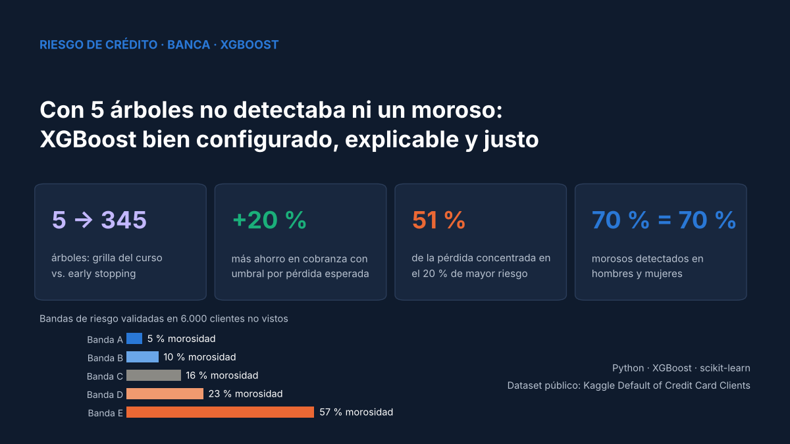
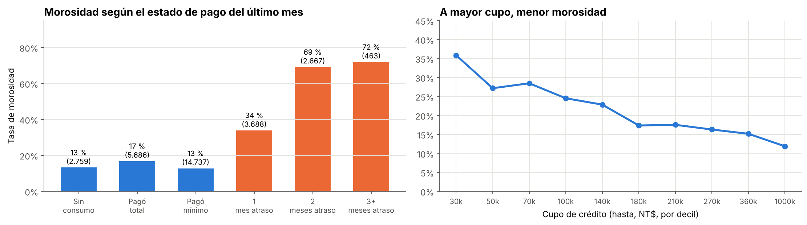
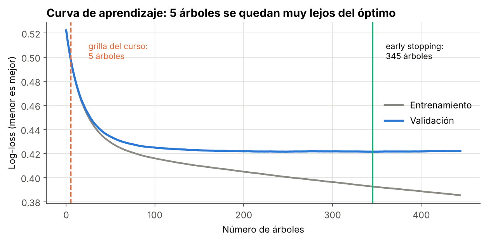
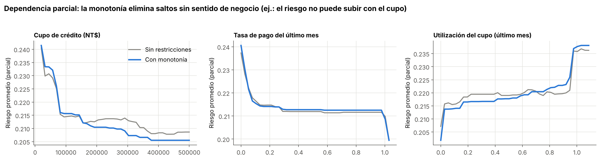
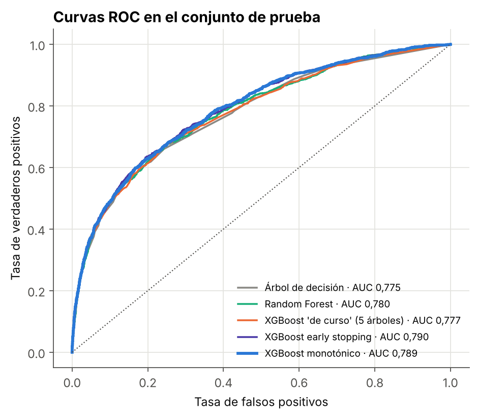
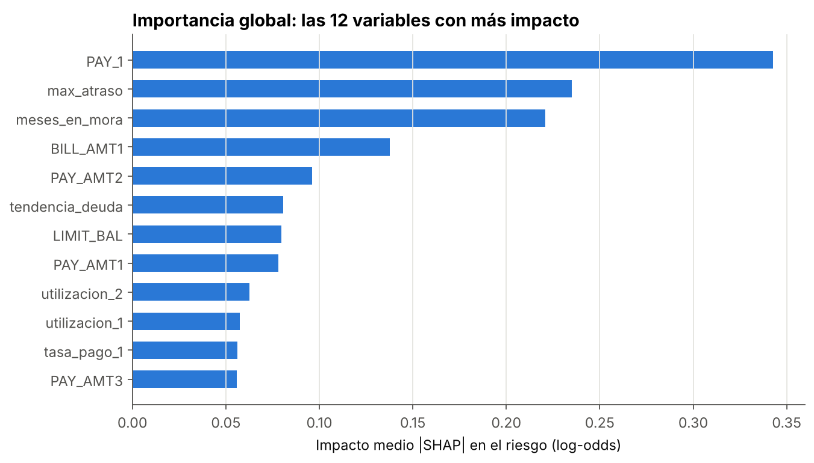
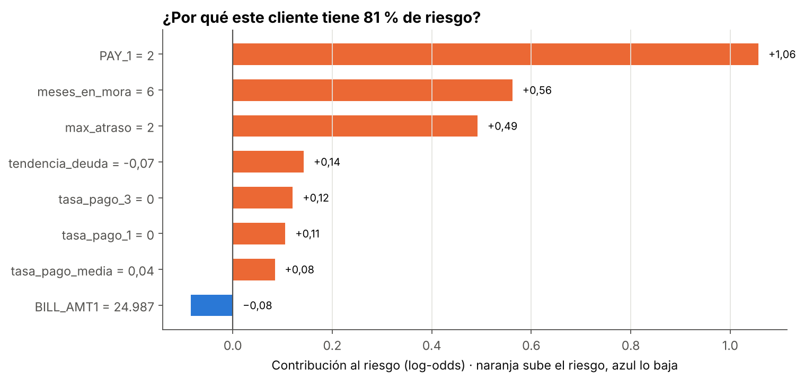
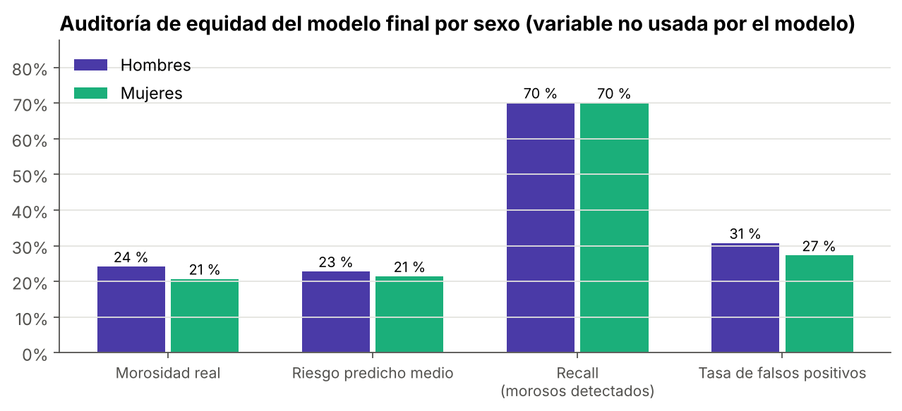
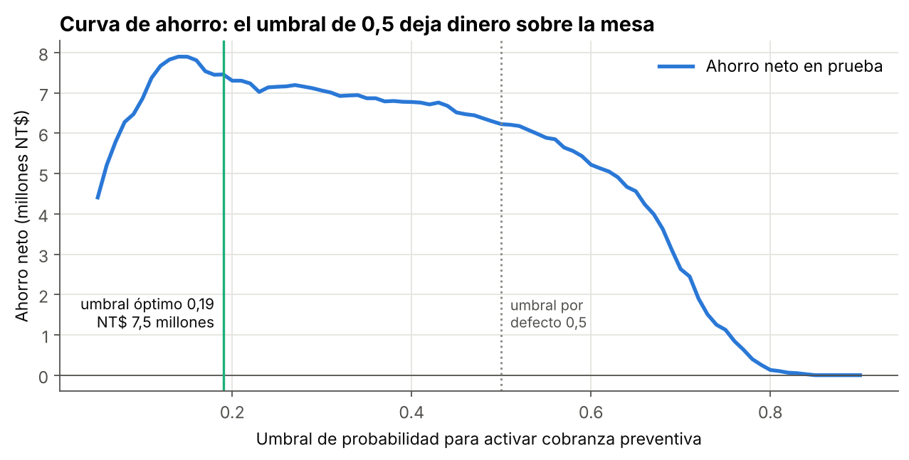
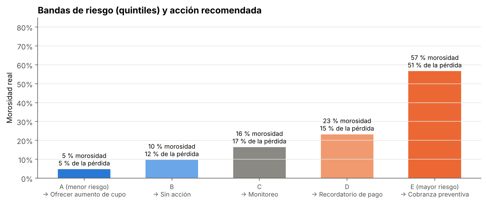

# 💳 Riesgo de crédito con XGBoost: explicable, coherente y justo

> **Con 5 árboles, XGBoost no detectaba ni un solo moroso.** Este proyecto muestra cómo configurarlo bien (early stopping), hacerlo coherente con el negocio (restricciones monotónicas), explicarlo cliente a cliente (TreeSHAP), auditar su equidad y convertirlo en una política de cobranza que maximiza el ahorro.




---

## 🎯 Problema de negocio

Un emisor de tarjetas de crédito quiere anticipar qué clientes **no pagarán su próxima cuota** (22 % de la cartera) para actuar antes con cobranza preventiva. En banca, un buen modelo de riesgo debe además:

1. **Ser coherente:** más meses de atraso nunca pueden *bajar* el riesgo.
2. **Ser explicable:** justificar por qué se marcó a cada cliente.
3. **No discriminar:** sexo o estado civil no deben decidir el resultado.
4. **Optimizar dinero:** un moroso no detectado cuesta mucho más que una llamada innecesaria.

## 📊 Resultados principales

| Indicador | Resultado |
|---|---|
| XGBoost "de curso" (5 árboles) | **0 morosos detectados** (todas sus probabilidades quedan entre 0,16 y 0,45) |
| XGBoost con early stopping | **345 árboles** · ROC-AUC **0,790**, el mejor de la serie |
| Costo de imponer monotonía | ROC-AUC 0,790 → 0,789 (prácticamente nulo) |
| Quitar sexo y estado civil | ROC-AUC 0,789 → 0,790 (no aportaban nada) |
| Ahorro con umbral por pérdida esperada | **+20 %** frente al umbral de 0,5 (NT$ 7,5 vs. 6,2 millones en la muestra de prueba) |
| Banda de mayor riesgo (20 % de los clientes) | **57 % de morosidad · 51 % de la pérdida** |
| Detección de morosos por sexo | **70 % en hombres y 70 % en mujeres** |

## 🕵️ Auditoría: cero nulos, pero códigos que el diccionario no explica

`isna()` reporta cero faltantes, pero la documentación oficial no coincide con los datos:

| Variable | Códigos no documentados | Filas | Decisión |
|---|---|---|---|
| `EDUCATION` | 0, 5, 6 | 345 (1,1 %) | Agrupar en "otros" |
| `MARRIAGE` | 0 | 54 (0,2 %) | Agrupar en "otros" |
| `PAY_n` | −2 (sin consumo), 0 (pagó el mínimo) | **17.496 (58 %)** | Conservar y crear variables explícitas |

Esa revisión condiciona el diseño: como −2, −1 y 0 **no tienen un orden de riesgo** (pagar el total tiene 17 % de morosidad y pagar el mínimo 13 %), no se les impone monotonía. En su lugar se crearon `meses_en_mora` y `max_atraso`.

## 🔍 Hallazgos del análisis exploratorio



- **El estado de pago del último mes domina el riesgo:** con 2 o más meses de atraso, la morosidad sube a 69-72 %.
- **El cupo actúa como proxy de la evaluación previa del banco:** los cupos más bajos incumplen el triple que los más altos.

## 🌲 Por qué 5 árboles no bastan: early stopping

El *boosting* construye árboles en secuencia, cada uno corrigiendo al anterior, y necesita cientos de pasos pequeños. En vez de adivinar `n_estimators`, se fija un máximo de 3.000 y el entrenamiento **se detiene cuando la pérdida en validación deja de mejorar durante 100 rondas**:



## 📐 Restricciones monotónicas: coherencia de negocio

XGBoost permite obligar al modelo a que el riesgo solo **suba** con los meses en mora, el atraso y la utilización del cupo, y solo **baje** con el cupo y la tasa de pago. El costo predictivo es prácticamente nulo y el modelo queda defendible ante un comité de riesgo:



## 🏆 Cierre de la serie: árbol vs. random forest vs. XGBoost

| Modelo | Accuracy | Precision | Recall | F1 | ROC-AUC | PR-AUC |
|---|---|---|---|---|---|---|
| Árbol de decisión | 0,817 | 0,650 | 0,377 | 0,477 | 0,775 | 0,545 |
| Random Forest | 0,820 | 0,667 | 0,375 | 0,480 | 0,780 | 0,564 |
| XGBoost "de curso" (5 árboles) | 0,779 | 0,000 | 0,000 | 0,000 | 0,777 | 0,555 |
| XGBoost early stopping | **0,822** | 0,671 | **0,378** | **0,484** | **0,790** | **0,576** |
| **XGBoost monotónico** ⭐ | 0,821 | **0,672** | 0,376 | 0,482 | 0,789 | 0,574 |

*Métricas al umbral de 0,5 sobre 6.000 clientes de prueba. En este dataset el margen entre modelos es estrecho: el valor diferencial está en la coherencia, la explicabilidad y la decisión de negocio.*

<p align="center"></p>

## 🔬 Explicaciones: globales y cliente a cliente

XGBoost calcula los **valores SHAP exactos de forma nativa** (`pred_contribs=True`), sin librerías adicionales:

<p align="center">
  
  
</p>

*"Su riesgo es alto principalmente por 2 meses de atraso en septiembre, atrasos en los 6 meses del historial y abonos prácticamente nulos respecto de su deuda."* Es el tipo de justificación que exigen los reguladores para decisiones automatizadas de crédito.

## ⚖️ Auditoría de equidad

El modelo final **excluye sexo y estado civil** (no aportaban rendimiento) y aun así se audita por grupo:



- El riesgo predicho sigue de cerca la morosidad real de cada grupo.
- La detección de morosos es **idéntica (70 %)**.
- La tasa de falsos positivos es 4 puntos mayor en hombres, coherente con su mayor morosidad real. Conviene monitorearla en producción.

## 💰 Del modelo a la política de crédito

**Supuestos (editables):** pérdida dado el incumplimiento 60 %, la cobranza preventiva evita el 40 % de la pérdida de un moroso real, y molestar a un buen cliente cuesta el 5 % de su deuda más NT$ 200 de gestión. El umbral se elige en validación y se evalúa en prueba:





| Banda | Morosidad real | % de la pérdida | Acción |
|---|---|---|---|
| A (menor riesgo) | 5 % | 5 % | Ofrecer aumento de cupo |
| B | 10 % | 12 % | Sin acción |
| C | 16 % | 17 % | Monitoreo |
| D | 23 % | 15 % | Recordatorio de pago |
| E (mayor riesgo) | 57 % | 51 % | Cobranza preventiva |

## 🗂️ Estructura del repositorio

```
credit-risk-xgboost/
├── data/                         # Dataset (no versionado, ver data/README.md)
├── images/                       # Gráficos generados por el notebook
├── notebooks/
│   └── analisis_riesgo_credito_xgboost.ipynb
├── reports/
│   ├── comparacion_modelos.csv
│   ├── auditoria_equidad.csv
│   ├── bandas_riesgo.csv
│   └── modelo_xgboost_credito.joblib
├── requirements.txt
├── LICENSE
└── README.md
```

## ▶️ Cómo reproducirlo

```bash
git clone https://github.com/Cristobal-111/credit-risk-xgboost.git
cd credit-risk-xgboost
pip install -r requirements.txt
# Descarga UCI_Credit_Card.csv desde Kaggle y cópialo en data/
jupyter notebook notebooks/analisis_riesgo_credito_xgboost.ipynb
```

En Google Colab: [](https://colab.research.google.com/github/Cristobal-111/credit-risk-xgboost/blob/main/notebooks/analisis_riesgo_credito_xgboost.ipynb) (sube `UCI_Credit_Card.csv` al panel de archivos de Colab antes de ejecutar). La ejecución completa toma alrededor de 1-2 minutos.

## ⚠️ Limitaciones

- Datos de un banco de Taiwán en 2005, durante una crisis de tarjetas de crédito en ese país: los niveles de morosidad no son extrapolables directamente.
- Los parámetros económicos son ilustrativos y deben calibrarse con datos reales.
- Siguiente nivel: probabilidades calibradas y validación *out-of-time* con periodos posteriores.

## 📚 Fuente de datos

[Default of Credit Card Clients — Kaggle](https://www.kaggle.com/datasets/uciml/default-of-credit-card-clients-dataset). Datos originales: Yeh, I. C. y Lien, C. H. (2009). *The comparisons of data mining techniques for the predictive accuracy of probability of default of credit card clients*. Expert Systems with Applications, 36(2), 2473-2480.

## 🔗 Serie de proyectos

1. 📉 [Fuga de clientes en telecomunicaciones · Árbol de decisión](https://github.com/Cristobal-111/churn-prediction-telco)
2. 🏨 [Cancelaciones hoteleras · Random Forest](https://github.com/Cristobal-111/hotel-cancellation-random-forest)
3. 💳 **Riesgo de crédito · XGBoost** (este repositorio)
4. 🏥 [Inasistencia a citas médicas · Proyecto integral PACE](https://github.com/Cristobal-111/medical-no-show-pace)
5. 👥 [People Analytics: rotación laboral · Regresión logística interpretable](https://github.com/Cristobal-111/hr-attrition-people-analytics)

## 👤 Autor

**Cristobal Rojas** · Analista de Datos
[LinkedIn](https://www.linkedin.com/in/cristobal-rojas-troncoso/) · [GitHub](https://github.com/Cristobal-111)
